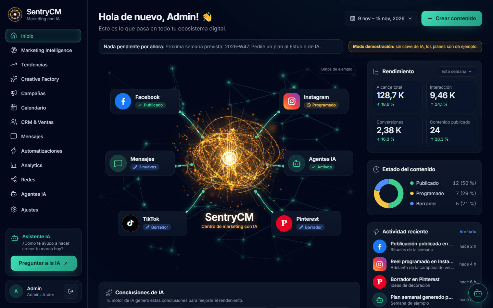
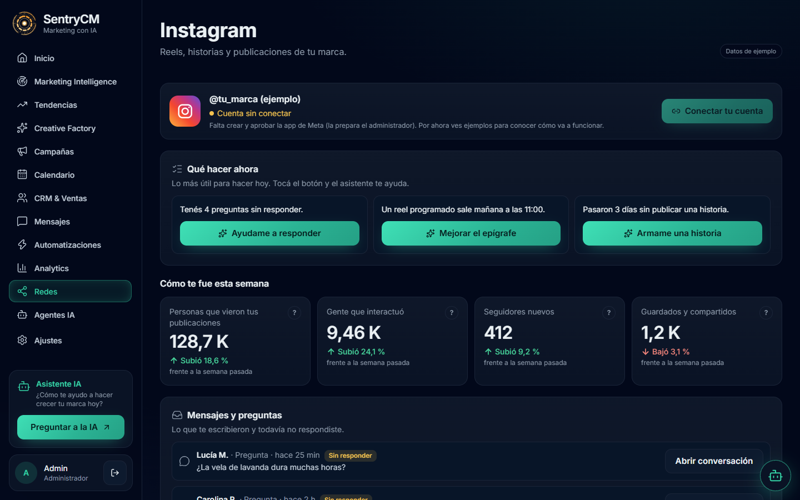
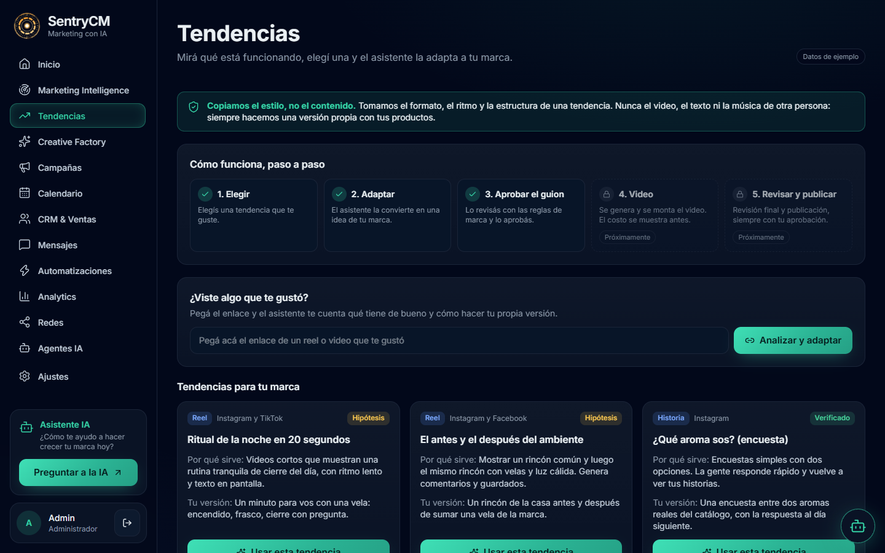
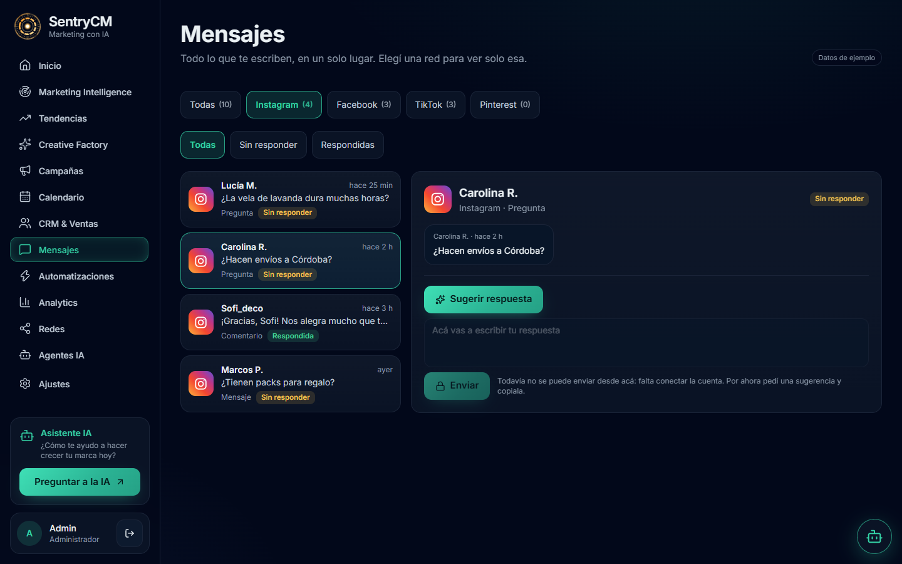
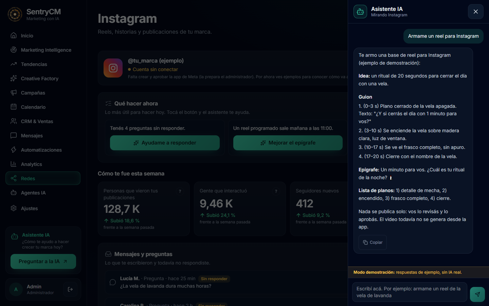
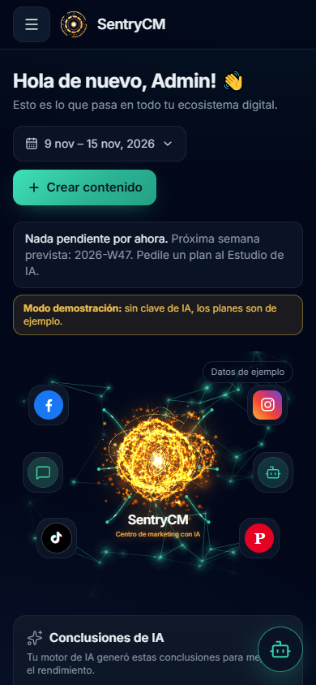
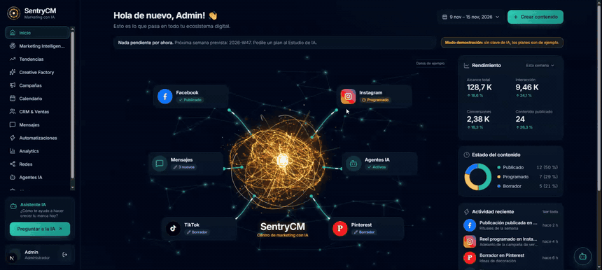

# ZentryCM

**SaaS de marketing con IA: genera contenido para redes con la voz de tu marca, lo revisa contra tus reglas y lo deja listo para aprobar y programar, todo en un solo lugar.**

> Estado: **en desarrollo activo** · Primera versión funcional construida y probada · Este repositorio es una **vitrina pública** (descripción, capturas y demo). El código fuente es privado.



---

## Qué es

ZentryCM es una plataforma para que una marca pequeña pueda mantener sus redes sociales con constancia y calidad, sin un equipo de marketing y sin saber de programación o de inteligencia artificial.

Una persona le pide a la IA lo que necesita ("armame un plan para esta semana", "quiero un reel de este producto"). La plataforma genera las piezas con el tono de la marca, las **revisa automáticamente contra las reglas de la marca** y las deja listas para que una persona las **apruebe**. Nada se publica sin esa aprobación.

Está pensada para uso diario en el celular y para crecer de una marca a muchas (cada dato del sistema pertenece a una marca desde el diseño).

## El problema

- Publicar con regularidad en Instagram, Facebook, TikTok y Pinterest consume horas que una marca chica no tiene.
- Las herramientas de IA genéricas inventan datos, hacen promesas que la marca no puede cumplir y no conocen su estilo.
- Las herramientas profesionales de marketing son complejas, caras y están hechas para equipos especializados.

## Cómo funciona

```
Pedir  →  Generar con IA  →  Revisión de marca  →  Aprobación humana  →  Calendario / Publicación
```

1. **Pedir.** En lenguaje normal, desde la web o el chat del asistente.
2. **Generar.** La IA arma las piezas con el contexto de la marca (productos, tono, reglas).
3. **Revisar.** Un revisor automático marca promesas de salud, precios o datos inventados, urgencia falsa y afirmaciones de seguridad sin base, antes de que la persona vea la pieza.
4. **Aprobar.** La persona acepta o pide cambios con un comentario; la IA reescribe (con un máximo de ciclos).
5. **Programar.** Las piezas aprobadas se organizan en un calendario semanal.

## Funciones

| Función | Qué hace |
|---|---|
| **Creative Factory** | Genera un plan semanal de contenido con IA, con progreso visible y sin planes a medias si algo falla. |
| **Revisión de marca** | Reglas verificables más una segunda revisión opcional por IA. |
| **Aprobación** | Aprobar o pedir cambios, con registro de quién y cuándo. |
| **Calendario** | Vista de la semana con el estado de cada pieza. |
| **Redes** | Una página por red (Instagram, Facebook, TikTok, Pinterest) con números explicados en lenguaje simple y acciones sugeridas. |
| **Tendencias** | Ideas que están funcionando, adaptadas a la marca: se copia el formato y el ritmo, **nunca el contenido de otra persona**. |
| **Mensajes** | Bandeja única de todas las redes con filtro por red y por estado; la IA sugiere respuestas, una persona las envía. |
| **Asistente IA** | Chat disponible en todas las pantallas: guiones de reel, ideas, adaptación de tendencias y ayuda para usar la plataforma. |
| **Modo demostración** | Sin clave de IA, la plataforma funciona con ejemplos guiados. |
| **App instalable (PWA)** | Se instala en el celular como una aplicación. |

### Capturas

| Redes | Tendencias |
|---|---|
|  |  |

| Mensajes | Asistente IA |
|---|---|
|  |  |

<p align="center"></p>

## Demo



Recorrido por las pantallas principales (Inicio, Redes, Tendencias, Mensajes y Asistente IA). También en video: [`demo/recorrido.mp4`](demo/recorrido.mp4). Un video con la plataforma en movimiento (holograma 3D y red neuronal animados) está en preparación.

> Todos los datos de redes, tendencias y mensajes que se ven son **de ejemplo**: la conexión con las cuentas reales está en la hoja de ruta.

## Principios de producto

- **Aprobación humana siempre.** La IA propone; una persona decide.
- **Honestidad del contenido.** Sin promesas de salud, sin precios ni cifras inventadas, sin urgencia falsa.
- **Pensada para no técnicos.** Lenguaje simple, explicaciones en cada número, pocas decisiones por pantalla.
- **Costos bajo control.** Tope mensual de gasto de IA y registro de cada consumo.
- **Copiar el estilo, no el contenido.** Las tendencias se adaptan a la marca; no se replica material ajeno.

## Enfoque técnico

- **Frontend y servidor:** Next.js (App Router) · React · TypeScript · Tailwind CSS
- **Datos:** PostgreSQL · Drizzle ORM · validación con Zod
- **IA:** API de Claude (Anthropic), con caché de contexto de marca, tope de gasto y registro de uso
- **Visual:** holograma 3D con three.js y red neuronal animada en canvas, ambos con soporte de "reducir movimiento"
- **Calidad:** especificaciones con criterios de aceptación numerados (Spec-Driven Development), decisiones de arquitectura documentadas, **50 pruebas unitarias, 11 de integración y 63 de extremo a extremo** (Vitest y Playwright)
- **Arquitectura:** monolito modular — reglas de negocio puras, adaptadores a servicios externos y capa de interfaz separadas
- **Seguridad:** autenticación propia con sesiones en base de datos, contraseñas con scrypt, bloqueo por intentos fallidos, sin registro público, secretos fuera del repositorio

## Hoja de ruta

- [x] Acceso, panel, Inicio, Creative Factory, revisión de marca, aprobación y calendario
- [x] Redes, Tendencias, Mensajes y chat con el asistente (con datos de ejemplo)
- [ ] Conexión con cuentas reales (Meta, TikTok, Pinterest)
- [ ] Bandeja de mensajes real con respuestas asistidas
- [ ] Prueba con IA real y guardado de borradores del chat como piezas
- [ ] Generación de video con control de costos
- [ ] Multi-marca, planes y facturación

## Sobre el código

El código fuente de ZentryCM es **privado**. Este repositorio muestra el producto y su enfoque. Si querés ver una demostración en vivo o conversar sobre el proyecto, escribime.

Todos los derechos reservados.

---

## English summary

**ZentryCM** is an in-development SaaS that helps small brands run their social media: it generates content in the brand's voice with AI, automatically checks it against the brand's rules (no invented prices, no health claims, no fake urgency), and queues it for **human approval** before anything is scheduled. It includes a weekly planner, per-network pages (Instagram, Facebook, TikTok, Pinterest), a trends module that adapts formats without copying content, a unified inbox with AI-suggested replies, and an AI assistant chat. Built with Next.js, React, TypeScript, PostgreSQL, Drizzle and the Claude API, with 124 automated tests. The source code is private; this repository is a public showcase.
